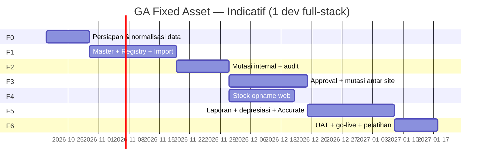

# Roadmap — Sistem Pengelolaan Aset (GA Fixed Asset)

> **Versi dokumen:** 1.2  
> **Tanggal:** 16 Oktober 2026  
> **Status:** **Fase 1 partial** — Fase 2 belum mulai (dev tim lain)  
> **Scope:** Full-stack (LUMEN-V3 backend + React frontend)  
> **Sumber data awal:** `GA - Asset Total (1).xlsx` (~11.434 aset, sheet `DATA`)

### Status implementasi (ringkas)

| Fase | Status | Catatan |
|------|--------|---------|
| **F0** | Partial | Mapping kolom import; alias cabang seeded; normalisasi ruang formal belum |
| **F1** | **~50%** | Import Excel, Daftar Aset, `purchase_date`, kondisi ID; belum: master ruang, tambah aset, label PDF, audit F1 penuh |
| **F2** | **Not started** | [`docs/TRELLO-TASKS-GA-FIXED-ASSET-F2.md`](./TRELLO-TASKS-GA-FIXED-ASSET-F2.md) |
| **F3** | **Not started** | [`docs/TRELLO-TASKS-GA-FIXED-ASSET-F3.md`](./TRELLO-TASKS-GA-FIXED-ASSET-F3.md) — blocked until F2 done |
| **F4–F6** | Not started | — |

**Backlog Trello F1 sisa:** [`docs/TRELLO-TASKS-GA-FIXED-ASSET-F1.md`](./TRELLO-TASKS-GA-FIXED-ASSET-F1.md)

---

## 1. Ringkasan eksekutif

Modul **GA Fixed Asset** menggantikan pengelolaan aset berbasis Excel menjadi sistem terpusat: registrasi & **NO CS** sebagai barcode, monitoring **lokasi saat ini** (site + ruang), mutasi dengan **audit trail**, **stock opname** di web (scanner USB), dan **approval paralel** untuk aksi sensitif (mutasi antar cabang, take over, rusak berat, hilang, dll.).

### Keputusan produk (locked)

| # | Keputusan |
|---|-----------|
| 1 | Integrasi **lumen-v3** + **frontend** React (pola `makeSlice`, `menu_slug`) |
| 2 | **Satu database** `intilab_produksi`; cabang/site = **`master_cabang`** (reuse, bukan tabel site baru) |
| 3 | **NO CS** format existing (`CS-KURSI-001`, …) = `asset_code` + barcode |
| 4 | **RB** = Rusak Berat, **TO** = Take Over, **2nd** = second hand |
| 5 | **Tanpa mobile app/PWA** — web desktop; scan via USB barcode (keyboard wedge) |
| 6 | Foto/dokumen **opsional** |
| 7 | Approval **paralel**: semua manager yang ditetapkan wajib approve |
| 8 | **Lokasi cabang:** FK `id_cabang` → `master_cabang.id` (model `MasterCabang`) |

### Asumsi / TBD (isi sebelum sprint terkait)

| Topik | Asumsi default | Konfirmasi |
|-------|----------------|------------|
| Accurate | Fase 5: export + flag manual (`accurate_sync_flag`) | Finance |
| Frekuensi opname | Bulanan per site (selaras sheet `SO`) | GA |
| Sumber approver | Master **GA Asset Approver** per site + bisa tambah manual saat submit | GA + HRD |
| Satu reject | Pengajuan **rejected**; GA **revisi & submit ulang** (dokumen baru atau reopen — tentukan saat Fase 3) | GA |

### Pola codebase yang direuse

| Pola | Referensi |
|------|-----------|
| Controller + slice API | Modul HRD (`PermohonanCuti`, `RekapLembur`) |
| Workflow / approval | `LimsDocumentApproval`, `WsFinalApprovalService`, salary adjustment tokens |
| Import Excel | Pola export/import modul rekap existing |
| Master cabang | `MasterCabang`, `id_cabang` (sama dengan karyawan, order, recruitment) |
| Tab + inbox approval | `PermohonanPenyesuaianKaryawan.js`, LIMS workflow API |
| Migration naming | `2026_MM_DD_HHMMSS_*` di `database/migrations/` |

### Bounded context

Namespace: **`ga_fixed_asset`** — tabel prefix `ga_asset_*`, controller `GaAsset*Controller`.

---

## 2. Aktor & hak akses

| Aktor | Hak utama |
|-------|-----------|
| **GA Admin** | Master data, import, cetak label, mutasi internal, buka/tutup opname, kelola kebijakan approver |
| **GA Staff** | CRUD aset (terbatas), mutasi internal, opname, ajukan approval |
| **Manager / Approver** | Inbox approval: approve/reject + catatan |
| **Finance Viewer** | Read-only aset + laporan nilai (Fase 5) |
| **Super Admin** | Konfigurasi menu, override darurat (tercatat audit) |

### Permission (menu_slug — usulan)

| menu_slug | Deskripsi |
|-----------|-----------|
| `ga-fixed-asset-master` | Ruang (per cabang), kategori, template kode, approver; cabang = read dari `master_cabang` |
| `ga-fixed-asset-registry` | Daftar & detail aset |
| `ga-fixed-asset-movement` | Mutasi |
| `ga-fixed-asset-opname` | Stock opname |
| `ga-fixed-asset-approval` | Pengajuan + inbox manager |
| `ga-fixed-asset-label` | Cetak label |
| `ga-fixed-asset-report` | Dashboard & laporan |

---

## 3. Pemetaan menu frontend

Base path (menu): **`/general-affair/assets/`**

| Halaman | Route | Backend controller (usulan) |
|---------|-------|----------------------------|
| Import Excel | `/general-affair/assets/import-excel` | `GaAssetImportController` |
| Daftar Aset | `/general-affair/assets/daftar-aset` | `GaAssetRegistryController` |
| Master Ruang (per cabang) | *(fase berikutnya)* | `GaAssetMasterController` |
| Master Kategori | `.../master/categories` | `GaAssetMasterController` |
| Master Template NO CS | `.../master/code-templates` | `GaAssetMasterController` |
| Master Approver | `.../master/approvers` | `GaAssetApprovalController` |
| Daftar Aset | `.../registry` | `GaAssetRegistryController` |
| Detail Aset | `.../registry/:code` | `GaAssetRegistryController` |
| Mutasi | `.../movements` | `GaAssetMovementController` |
| Pengajuan Saya | `.../approvals/mine` | `GaAssetApprovalController` |
| Inbox Approval | `.../approvals/inbox` | `GaAssetApprovalController` |
| Stock Opname | `.../opname` | `GaAssetOpnameController` |
| Cetak Label | `.../labels` | `GaAssetLabelController` |
| Dashboard | `.../dashboard` | `GaAssetReportController` |
| Import Excel | `.../tools/import` | `GaAssetImportController` |

---

## 4. Model data (ringkas)

Implementasi bertahap per fase; urutan migration disarankan:

1. Master: **`master_cabang`** (existing), `ga_asset_rooms`, `ga_asset_category_l1/l2`, `ga_asset_useful_life_rules`, `ga_asset_type_templates`
2. Core: `ga_assets`, `ga_asset_attachments`, `ga_asset_audit_logs`
3. Operasional: `ga_asset_movements`, `ga_asset_condition_logs`
4. Approval: `ga_asset_approval_requests`, `ga_asset_approval_assignees`, `ga_asset_approval_actions`, `ga_asset_approval_policies`, `ga_asset_cabang_approvers`
5. Opname: `ga_asset_opnames`, `ga_asset_opname_sessions`, `ga_asset_opname_lines`
6. Finance (Fase 5): `ga_asset_depreciation_yearly`

### 4.1 Integrasi `master_cabang` (site)

**Tidak ada** tabel `ga_asset_sites`. Semua referensi “site/lokasi/cabang” memakai:

| Sumber | Kolom penting |
|--------|----------------|
| `master_cabang` | `id`, `kode_cabang`, `nama_cabang`, `is_active` (filter aktif seperti modul lain) |

**FK di modul GA:**

| Tabel | Kolom | Keterangan |
|-------|--------|------------|
| `ga_asset_rooms` | `id_cabang` | Ruang unik per `(id_cabang, nama_ruang)` |
| `ga_assets` | `id_cabang`, `room_id` | `id_cabang` denormalized untuk filter cepat; sinkron dari `room` saat mutasi |
| `ga_asset_movements` | `from_id_cabang`, `to_id_cabang`, `from_room_id`, `to_room_id` | Audit mutasi antar cabang |
| `ga_asset_opnames` | `id_cabang` | Opname per cabang + periode |
| `ga_asset_cabang_approvers` | `id_cabang`, `karyawan_id` | Approver default per cabang |

**API master cabang:** reuse endpoint/list yang sudah ada (contoh pola `MasterCabang::where('is_active', true)`) — modul GA **tidak** CRUD cabang kecuali role admin cabang global sudah ada di modul lain.

**Import Excel — mapping `LOKASI` → `id_cabang`:**

| Nilai Excel (contoh) | Aksi F0 |
|----------------------|---------|
| `PUSAT` | Map ke baris `master_cabang` (mis. Head Office / Pusat — **verifikasi id di DB**) |
| `CABANG KARAWANG` | Map ke cabang Karawang |
| `CABANG PEMALANG`, `PEMALANG` | Merge ke satu `id_cabang` Pemalang |
| `CABANG PEMALANG - KARAWANG` | Keputusan GA: assign ke satu cabang atau ruang khusus |

Simpan mapping di sheet **`cabang-import-alias.xlsx`** (alias Excel → `master_cabang.id`) agar import repeatable.

**Hak akses cabang (opsional F2+):** jika user punya `privilageCabang` seperti modul order/report, filter registry/opname dengan `whereIn('ga_assets.id_cabang', $privilageCabang)`.

### Enum status

**operational_status:** `normal`, `kendala`, `rusak`, `rusak_berat`, `hilang`, `transfer`  
**acquisition_status:** `new`, `second`, `take_over`

---

## 5. Roadmap fase (overview)

> **Catatan:** F4 bisa **paralel** dengan F3 setelah F2 selesai jika tim 2 orang (BE + FE). Durasi indicatif; sesuaikan kapasitas tim.

---

## 6. Fase 0 — Persiapan (≈ 1–2 minggu)

**Tujuan:** Data dan scope siap coding; risiko import teridentifikasi.

| ID | Task | Output | Owner |
|----|------|--------|-------|
| F0-1 | Workshop GA: finalisasi TBD (opname, approver, Accurate) | Notulen keputusan | GA + PM |
| F0-2 | Ekstrak **LOKASI + RUANG**; map LOKASI → **`master_cabang.id`** + merge duplikat ruang | `cabang-import-alias.xlsx` + `room-normalization.xlsx` | GA |
| F0-3 | Mapping kolom sheet `DATA` → field DB | Dokumen mapping (lampiran §8) | Dev |
| F0-4 | Tentukan daftar **request_type** approval | Tabel §7.1 | GA + Dev |
| F0-5 | Setup menu & role di DB (seed menu_slug) | Migration seed / SQL | Dev |
| F0-6 | Spike: library PDF barcode (Dompdf + picqer/php-barcode atau setara) | POC cetak 1 label | Dev |

**Exit criteria F0:** File normalisasi ruang disetujui GA; menu_slug terdaftar; mapping kolom signed-off.

---

## 7. Fase 1 — Foundation: master + registry + import + label (≈ 3–4 minggu)

**Tujuan:** Aset terbaca di sistem, bisa import dari Excel, bisa cetak label.

### 7.1 Backend

| ID | Task | Depends |
|----|------|---------|
| F1-B1 | Migration master (room + category L1/L2, templates, useful life); FK `id_cabang` → `master_cabang` | F0 |
| F1-B2 | Migration `ga_assets` + indexes (`id_cabang`, `room_id`, `asset_code`) | F1-B1 |
| F1-B3 | `GaAssetMasterController` — CRUD **room**/category/template; **index cabang** read-only | F1-B1 |
| F1-B4 | `GaAssetRegistryController` — index, show, store, update, soft rules NO CS | F1-B2 |
| F1-B5 | `GaAssetCodeGeneratorService` — generate `CS-{TYPE}-{SEQ}` | F1-B3 |
| F1-B6 | `GaAssetExcelImportService` — dry-run + commit dari sheet `DATA` | F1-B4, F0-2 |
| F1-B7 | `GaAssetLabelController` — batch PDF barcode Code 128 | F0-6 |
| F1-B8 | `ga_asset_audit_logs` — create/update/import/print label | F1-B4 |

### 7.2 Frontend

| ID | Task | Depends |
|----|------|---------|
| F1-F1 | Layout modul GA + routing | F0-5 |
| F1-F2 | Halaman Master Ruang (dropdown cabang dari `master_cabang`) + Kategori | F1-B3 |
| F1-F3 | Daftar Aset (filter, pagination, scan-friendly search) | F1-B4 |
| F1-F4 | Detail Aset (read-only dulu) | F1-B4 |
| F1-F5 | Form tambah aset + auto NO CS | F1-B5 |
| F1-F6 | Import Excel (upload, preview error, commit) | F1-B6 |
| F1-F7 | Cetak Label (multi-select, mark `label_applied`) | F1-B7 |

### 7.3 QA & data

| ID | Task |
|----|------|
| F1-Q1 | Import staging: bandingkan jumlah per CAT-1/CAT-2 vs sheet `SQ` |
| F1-Q2 | Sample 50 aset: NO CS, ruang, status N/NEW cocok Excel |

**Exit criteria F1:** ≥99% baris valid ter-import; cetak label batch; pencarian by scan NO CS < 1 detik (indexed).

---

## 8. Fase 2 — Mutasi internal + audit trail (≈ 2 minggu)

**Tujuan:** Posisi aset always current; riwayat lengkap untuk mutasi dalam site.

> **Planning Trello (1 kartu = BE+FE):** [`TRELLO-TASKS-GA-FIXED-ASSET-F2.md`](./TRELLO-TASKS-GA-FIXED-ASSET-F2.md) — 6 kartu: migration → mutasi ruang → ubah kondisi → timeline → UAT → runbook.

| ID | Task | Keterangan |
|----|------|------------|
| F2-B1 | Migration `ga_asset_movements`, `ga_asset_condition_logs` | |
| F2-B2 | `GaAssetMovementController` — mutasi ruang (same site), tanpa approval | |
| F2-B3 | `GaAssetRegistryController` — update kondisi (N/K/R/…) + log | |
| F2-B4 | API timeline di detail aset | movements + conditions + audit |
| F2-F1 | UI Mutasi (scan NO CS → pilih ruang tujuan) | |
| F2-F2 | UI ubah kondisi + catatan | |
| F2-F3 | Detail aset: tab Riwayat | |
| F2-Q1 | UAT: 10 mutasi + verifikasi `room_id` & history | |

**Exit criteria F2:** Mutasi same-site tanpa approval; setiap perubahan ruang/kondisi tercatat user + timestamp.

---

## 9. Fase 3 — Approval workflow + mutasi antar site (≈ 3 minggu)

**Tujuan:** Kebijakan perusahaan untuk aksi sensitif; eksekusi otomatis setelah semua manager approve.

> **Planning Trello (1 kartu = BE+FE):** [`TRELLO-TASKS-GA-FIXED-ASSET-F3.md`](./TRELLO-TASKS-GA-FIXED-ASSET-F3.md) — 7 kartu: migration → master approver → pengajuan → inbox + executor → notif → UAT → runbook. **Start setelah Fase 2 selesai.**

### 9.1 Jenis pengajuan (`request_type`)

| request_type | Trigger | Eksekusi setelah approved |
|--------------|---------|---------------------------|
| `movement_cross_site` | Pindah site (cabang ↔ pusat) | Update site + room + movement |
| `take_over` | Status → `take_over` + metadata | Update acquisition_status + log |
| `dispose_rusak_berat` | RB → penghapusan inventaris | operational_status + is_active |
| `report_hilang` | Status hilang | operational_status + log |
| `transfer_out` | Status transfer (T) | Sesuai kebijakan GA |

Mutasi **same site** tetap Fase 2 (no approval).

### 9.2 Tasks

| ID | Task |
|----|------|
| F3-B1 | Migration approval tables + `ga_asset_cabang_approvers` (`id_cabang`) |
| F3-B2 | `GaAssetApprovalService` — submit, approve, reject, parallel AND logic |
| F3-B3 | `GaAssetApprovalController` — mine, inbox, process |
| F3-B4 | Post-approve executor (transaction): apply payload ke asset |
| F3-B5 | Notifikasi inbox (reuse pola notifikasi internal) |
| F3-F1 | Form pengajuan (pilih approver dari master + optional tambahan) |
| F3-F2 | Inbox manager + badge count |
| F3-F3 | Detail pengajuan + timeline approval |
| F3-Q1 | UAT: 2 manager — approve 1 saja = masih pending; keduanya = executed |

**Exit criteria F3:** Cross-site mutasi tidak bisa tanpa approval completed; reject menghentikan eksekusi.

---

## 10. Fase 4 — Stock opname web (≈ 2–3 minggu)

**Tujuan:** Ganti sheet `SO`; scan di web dengan USB scanner.

| ID | Task |
|----|------|
| F4-B1 | Migration opname tables |
| F4-B2 | `GaAssetOpnameController` — buka periode, sesi ruang, scan line, close |
| F4-B3 | Rules: found / wrong_room / unknown barcode |
| F4-F1 | UI periode opname (per site, bulan/tahun) |
| F4-F2 | UI sesi ruang — input scan autofocus |
| F4-F3 | Rekap selisih + export Excel |
| F4-Q1 | UAT 1 ruang: bandingkan manual vs sistem |

**Exit criteria F4:** Close periode menghasilkan rekap: belum discan, salah ruang, OK.

**Dependency:** F2 (posisi ruang harus akurat).

---

## 11. Fase 5 — Laporan, depresiasi, Accurate (≈ 3–4 minggu, optional parallel)

**Tujuan:** Mirror kebutuhan finance dari sheet `Total` / `CAT`.

| ID | Task |
|----|------|
| F5-B1 | Seed useful life dari sheet `CAT` (Kemenkeu 295/KM.6/2019) |
| F5-B2 | `GaAssetDepreciationService` — snapshot tahunan (scheduled job) |
| F5-B3 | Laporan per CAT-1/CAT-2: perolehan, depresiasi, nilai buku |
| F5-B4 | Export CSV/API Accurate (setelah spec Finance) |
| F5-F1 | Dashboard GA: kartu site, pie kondisi, mutasi pending |
| F5-F2 | Halaman laporan finance (read-only role) |

**Exit criteria F5:** Nilai buku tahun N reconcilable dengan sample Excel untuk 1 kategori pilot.

---

## 12. Fase 6 — UAT, go-live, pelatihan (≈ 1–2 minggu)

| ID | Task |
|----|------|
| F6-1 | UAT sign-off GA + Finance (checklist) |
| F6-2 | Import produksi final + freeze Excel legacy |
| F6-3 | SOP: mutasi, approval, opname, cetak label |
| F6-4 | Pelatihan GA (2 sesi) + cheat sheet scanner USB |
| F6-5 | Hypercare 2 minggu pasca go-live |

**Go-live criteria:** Import prod OK; minimal 1 siklus opname pilot; approver master terisi **semua cabang aktif** di `master_cabang`.

---

## 13. Backlog teknis (lintas fase)

| Item | Prioritas | Fase |
|------|-----------|------|
| Attachment foto aset (opsional) | Medium | 2+ |
| Global shortcut `/` focus search | Low | 1 |
| Export registry Excel | Medium | 2 |
| Bulk mutasi (CSV) | Low | 3 |
| QR code (selain Code 128) | Low | 1+ |
| Retention audit log (tahun) | Low | 6 |

---

## 14. Mapping import Excel → `ga_assets` (sheet `DATA`)

| Kolom Excel (header baris 2) | Field DB |
|------------------------------|----------|
| NO CS | `asset_code` |
| CAT-1 | `category_l1_id` (lookup) |
| CAT-2 | `category_l2_id` (lookup) |
| D / M / Y (pembelian) | `purchase_date` |
| JENIS ASET + MERK (+ kolom spesifik) | `asset_name`, `brand`, `spec` |
| STATUS (NEW / 2nd / TO) | `acquisition_status` |
| LABEL (V) | `label_applied` |
| N / K / R / RB / H / T | `operational_status` (prioritas jika multi-flag — tentukan di F0) |
| RUANG | `room_id` (lookup) |
| LOKASI | `id_cabang` (lookup `master_cabang` via alias F0-2) |
| HARGA | `acquisition_cost` |
| UMUR MANFAAT | `useful_life_years` |
| CEK ACCURATE | `accurate_sync_flag` |
| KE RUANG + TGL MUTASI | seed `ga_asset_movements` (imported flag) |

---

## 15. Risiko & mitigasi

| Risiko | Dampak | Mitigasi |
|--------|--------|----------|
| Data ruang/lokasi tidak konsisten | Salah posisi massal | F0 normalisasi + validasi import |
| Multi-flag N+K di Excel | Status ambigu | Rule priority di F0-3 |
| Approver kosong di cabang | Pengajuan macet | Wajib isi master approver sebelum F3 go-live |
| Scope creep Accurate | Delay | Fase 5 terpisah; flag manual dulu |
| Performa 11k+ aset | Lambat di UI | Index, pagination, hindari N+1 |

---

## 16. Checklist definisi selesai (DoD) per task dev

- [ ] Migration up/down tested di local  
- [ ] Endpoint terdaftar + slice bisa dipanggil dari Postman  
- [ ] Validasi input + pesan error bahasa Indonesia jelas  
- [ ] Audit log untuk aksi bisnis penting  
- [ ] Halaman React: loading, empty state, error toast  
- [ ] Permission cek `menu_slug`  
- [ ] Review peer untuk Fase 3+ (approval & money-related)  

---

## 17. Urutan kerja disarankan (single developer)

1. F0 → F1-B1…B2 → F1-F1…F2 (master + registry)  
2. F1-B6 import + F1-Q1 (data masuk)  
3. F1-B7 label + F2 mutasi  
4. F3 approval (blocking cross-site)  
5. F4 opname (bisa mulai setelah F2)  
6. F5 laporan  
7. F6 go-live  

---

## 18. Changelog dokumen

| Versi | Tanggal | Perubahan |
|-------|---------|-----------|
| 1.0 | 2026-10-15 | Draft awal roadmap dari desain sistem + konfirmasi stakeholder |
| 1.1 | 2026-10-15 | Site/cabang reuse **`master_cabang`** (`id_cabang`); hapus `ga_asset_sites` |

---

**Kontak dokumen:** tim dev portal Intilab / GA — perbarui changelog saat scope berubah.
