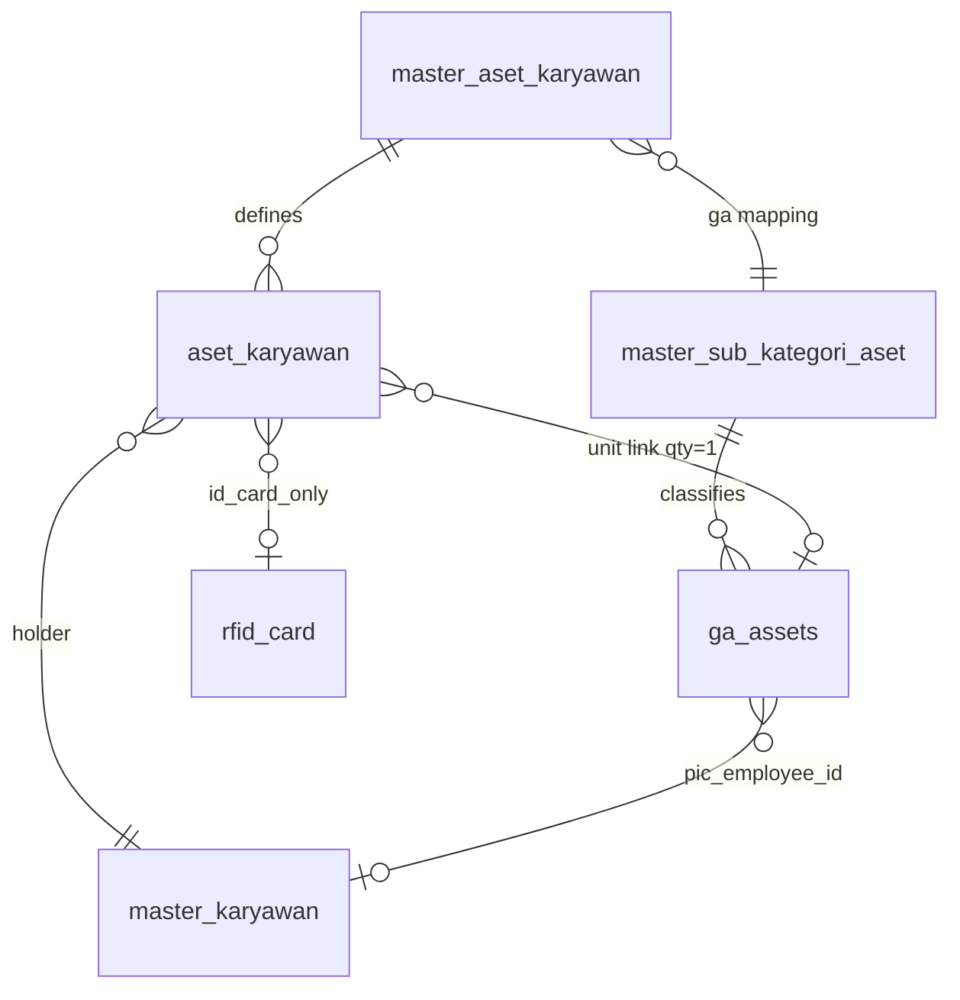

# Roadmap — Jembatan Aset Karyawan (HR) ↔ GA Fixed Asset (Finance)

> **Versi dokumen:** 1.0  
> **Tanggal:** 20 November 2026  
> **Status:** Fase 0–1 aktif (schema + API link); UI mapping & bulk follow-up  
> **Scope:** `lumen-v3` + `frontend-react-js`  
> **Terkait:** [ROADMAP-GA-FIXED-ASSET.md](./ROADMAP-GA-FIXED-ASSET.md), branch/PR `alawi/hc-aset`

---

## 1. Ringkasan eksekutif

Modul **aset karyawan** (migrasi ATS, SPPA, menu HR) berjalan **tanpa** data di **Finance → Daftar Aset** (`ga_assets`). Katalog sementara ada di `master_aset_karyawan` — daftar mengacu SPPA PDF ([MASTER-ASET-KARYAWAN-CATALOG.md](./MASTER-ASET-KARYAWAN-CATALOG.md)).

Dokumen ini mendefinisikan **jembatan dua lapis** agar saat GA Fixed Asset produksi siap, HR dapat:

1. **Mapping jenis** HR → **sub kategori GA** (`master_sub_kategori_aset`) — tanpa mengubah alur migrasi.
2. **Link unit** (opsional) baris `aset_karyawan` → **`ga_assets.id`** + sinkron **`pic_employee_id`**.

Tanpa jembatan ini, HR dan Finance tetap dua silo meskipun nama aset sama.

---

## 2. Bounded context

| Konteks | Tabel utama | Arti |
|---------|-------------|------|
| **HR — katalog jenis** | `master_aset_karyawan` | Tipe aset untuk dropdown / SPPA (bukan unit CS) |
| **HR — penerimaan** | `aset_karyawan` | Qty + satuan per karyawan; opsional RFID (ID Card) |
| **GA — taxonomy** | `master_kategori_aset`, `master_sub_kategori_aset` | Sama yang dipakai `GaAssetController` |
| **GA — register unit** | `ga_assets` | Satu baris = satu unit (NO CS / asset_code, PIC) |

**ID Card** → `rfid_card` + master "ID Card"; **tidak** di-link ke `ga_assets` (`ga_link_status = not_applicable`).

---

## 3. Model data (jembatan)

### 3.1 `master_aset_karyawan` (kolom GA — migration `2026_11_20_140000_*`)

| Kolom | Tipe | Keterangan |
|-------|------|------------|
| `sub_kategori_aset_id` | INT NULL | FK logis → `master_sub_kategori_aset.id` |
| `ga_link_status` | varchar(30) | `unmapped` \| `mapped_sub_kategori` |
| `ga_linked_at` / `ga_linked_by` | audit | Saat mapping diset / dihapus |

### 3.2 `aset_karyawan`

| Kolom | Tipe | Keterangan |
|-------|------|------------|
| `ga_asset_id` | BIGINT NULL | FK logis → `ga_assets.id` |
| `ga_link_status` | varchar(30) | `unlinked` \| `linked` \| `not_applicable` |
| `ga_linked_at` / `ga_linked_by` | audit | Saat link / unlink unit |

Migration dasar HR: `2026_11_19_120000_create_aset_karyawan_tables.php`.

### 3.3 Diagram (ringkas)

---

## 4. Fase implementasi

### Fase 0 — Fundasi HR (✅ branch `alawi/hc-aset`)

- Step **Assets** di migrasi hired-candidates
- Tabel `master_aset_karyawan` + `aset_karyawan` + seed
- `AsetKaryawanController`, `AtsHiredCandidatesController` (simpan aset migrasi)
- FE: `AssetInformation.js`, `AsetKaryawan.js`
- SPPA / `penerimaan-aset.blade.php`

### Fase 1 — Jembatan schema + API (✅ dokumen ini + kode)

| Deliverable | Lokasi |
|-------------|--------|
| Migration kolom GA | `database/migrations/2026_11_20_140000_add_ga_link_columns_to_hr_aset_tables.php` |
| Service link | `app/Services/HrAset/HrGaAssetLinkService.php` |
| CRUD + mapping master | `MasterAsetKaryawanController` |
| Link unit per baris | `AsetKaryawanController::linkGaAsset`, `unlinkGaAsset`, `searchAssignableGaAssets` |
| Default status saat create | `unlinked` / `not_applicable` (ID Card) |

**Deploy:** jalankan migration setelah merge Fase 0.

### Fase 2 — UI & operasional (TODO)

| # | Task | Owner | Keterangan |
|---|------|-------|------------|
| 2.1 | Menu FE **Master Aset Karyawan (Mapping)** | FE | DataTable + modal map sub kategori; slice `MasterAsetKaryawanController` |
| 2.2 | Extend **Modal Aset Karyawan** | FE | Tampilkan status link; tombol link unit jika `qty=1` & master mapped |
| 2.3 | Registrasi menu + slice DB | Ops | `hrd/hris/master-aset-karyawan`, `aset-karyawan`, endpoint link |
| 2.4 | Panduan mapping awal | HRD+GA | Excel/template: baris master HR → sub kategori GA |
| 2.5 | Laporan backlog link | BE/FE | Karyawan dengan aset `unlinked` padahal master sudah `mapped` |

### Fase 3 — GA produksi & bulk link (TODO, bergantung GA live)

| # | Task | Keterangan |
|---|------|------------|
| 3.1 | Import/populate `ga_assets` | Ikut [ROADMAP-GA-FIXED-ASSET.md](./ROADMAP-GA-FIXED-ASSET.md) |
| 3.2 | Mapping master HR batch | Script atau UI import mapping |
| 3.3 | Link unit batch / wizard | Opsional: filter karyawan + aset qty=1 |
| 3.4 | Integrasi mutasi GA | Saat offboarding: unlink HR + mutasi PIC GA (koordinasi `GaAssetMovementService`) |
| 3.5 | Qty > 1 | Tabel pivot `aset_karyawan_ga_asset` (desain di [HR-ASSET-FINANCE-LINK-ERD-API.md](./HR-ASSET-FINANCE-LINK-ERD-API.md)) |

### Fase 4 — Hard sync & audit (opsional)

- Event GA saat link/unlink (audit trail)
- Validasi publication_state aset sebelum assign PIC
- Dashboard: % master mapped, % baris linked

---

## 5. Aturan bisnis (locked)

| # | Aturan |
|---|--------|
| 1 | Migrasi ATS **tidak wajib** pilih unit GA — tetap master HR + qty |
| 2 | Link unit hanya jika master HR `mapped_sub_kategori` |
| 3 | Link unit hanya **`qty = 1`** (fase 1–3 awal); consumable cukup mapping master |
| 4 | Sub kategori unit GA **harus sama** dengan mapping master |
| 5 | Satu `ga_asset_id` hanya satu baris `aset_karyawan` aktif |
| 6 | Link unit set **`ga_assets.pic_employee_id`** = pemegang HR |
| 7 | Unlink dengan `clear_pic=true` kosongkan PIC jika masih karyawan yang sama |
| 8 | ID Card: `not_applicable`, tidak link GA |

---

## 6. API (ringkas)

Detail payload & slice: **[HR-ASSET-FINANCE-LINK-ERD-API.md](./HR-ASSET-FINANCE-LINK-ERD-API.md)**.

| Controller | Method (slice) | Fungsi |
|------------|----------------|--------|
| `MasterAsetKaryawanController` | `index`, `store`, `update`, `delete` | Master katalog HR |
| | `linkSubKategori` | Set/hapus `sub_kategori_aset_id` |
| | `getSubKategoriOptions` | Dropdown taxonomy GA |
| `AsetKaryawanController` | *(existing)* | CRUD per karyawan |
| | `searchAssignableGaAssets` | Cari unit assignable |
| | `linkGaAsset` / `unlinkGaAsset` | Link baris ↔ unit |
| `AtsHiredCandidatesController` | `getMasterAsetKaryawanOptions` | Migrasi (hint `[GA mapped]`) |

---

## 7. Menu frontend (usulan)

| Path | Komponen | Fase |
|------|----------|------|
| `/frontend/hrd/applicant-tracking-system/hired-candidates` | `AssetInformation` | 0 ✅ |
| `/frontend/hrd/hris/aset-karyawan` | `AsetKaryawan` | 0 ✅ |
| `/frontend/hrd/hris/master-aset-karyawan` | *(baru)* `MasterAsetKaryawan.js` | 2 |
| `/frontend/finance/aset/daftar-aset` | *(existing GA)* | referensi unit |

---

## 8. UAT matrix (singkat)

| Skenario | Expected |
|----------|----------|
| Migrasi tanpa aset | Sukses; tidak ada baris `aset_karyawan` |
| Migrasi + Laptop qty 1 | Baris `unlinked`; SPPA tampil Laptop |
| Migrasi ID Card + RFID | `not_applicable`; RFID ter-assign |
| Map master Laptop → sub kategori GA | `mapped_sub_kategori` |
| Link baris ke unit GA matching | `linked`; PIC GA = karyawan |
| Link sub kategori salah | 422 |
| Link qty 2 | 422 (sampai fase pivot) |
| Unlink + clear_pic | Baris `unlinked`; PIC null |

Checklist lengkap: **[HR-ASSET-FINANCE-LINK-PROGRESS.md](./HR-ASSET-FINANCE-LINK-PROGRESS.md)**.

---

## 9. Riwayat dokumen

| Versi | Tanggal | Perubahan |
|-------|---------|-----------|
| 1.0 | 2026-11-20 | Roadmap awal + Fase 1 backend |