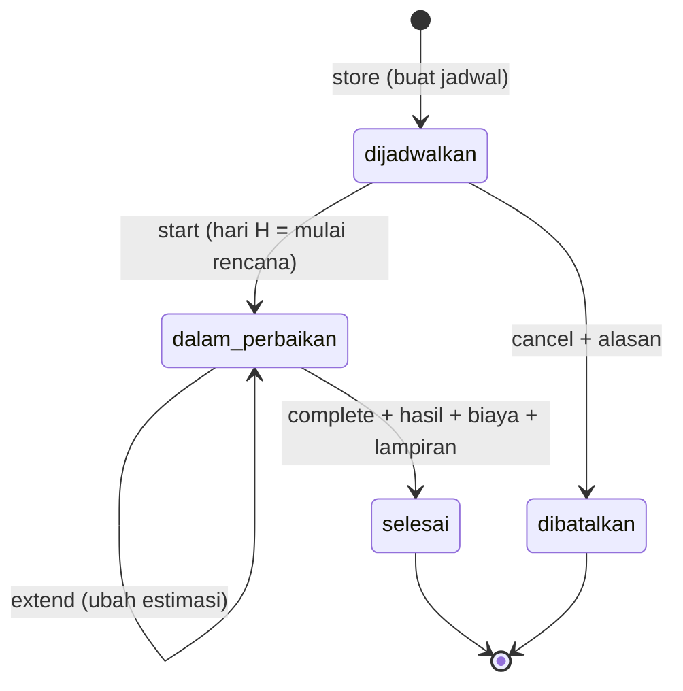
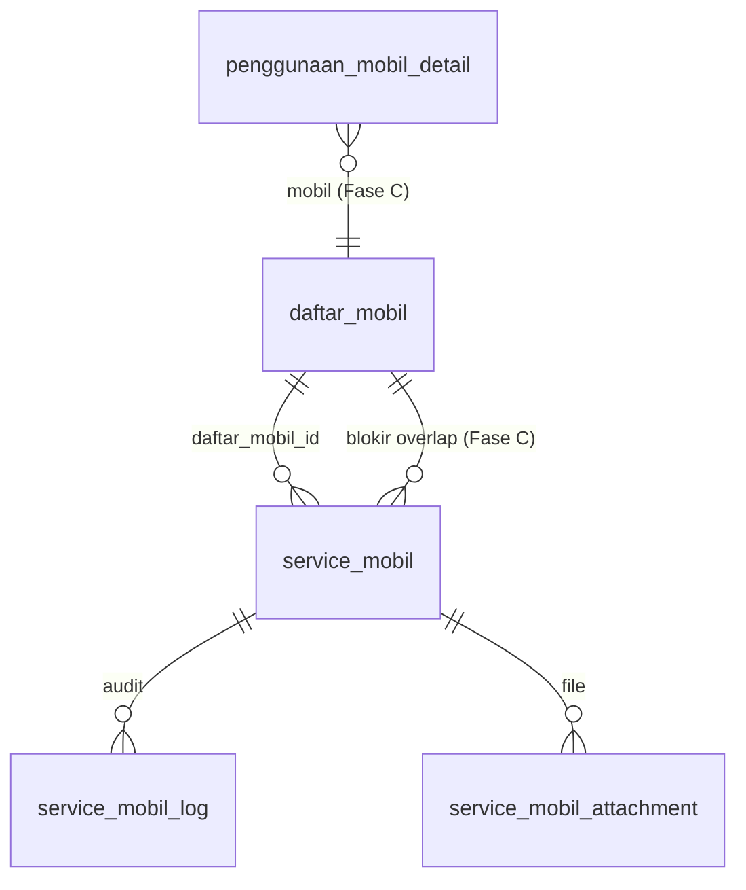

# Roadmap — Jadwal Service Mobil (GA)

> **Versi dokumen:** 2.1  
> **Terakhir diperbarui:** 20 November 2026  
> **Ruas modul:** `general-affair/jadwal-service-mobil` (+ integrasi `penggunaan-mobil`)  
> **Backend:** Lumen `JadwalServiceMobilController` · model `ServiceMobil*`  
> **Frontend:** `frontend-react-js/src/pages/general-affair/jadwal-service-mobil/`  
> **Dokumen ini:** rencana **apa yang sudah**, **apa yang akan dijalankan**, dan **kriteria selesai** per fase.

---

## 0. Ringkasan eksekutif

Modul **Jadwal Service Mobil** mengatur perawatan armada internal dari perencanaan sampai penyelesaian. **Mobil tidak boleh dipakai operasional** selama service berstatus **Dijadwalkan** atau **Dalam Perbaikan** (overlap tanggal).

| Track | Fokus | Status keseluruhan |
|-------|--------|---------------------|
| **T1 — Skema & API** | Penyederhanaan DB, log audit, kompatibilitas API | Fase awal + **B** + **A** ✅ |
| **T2 — Integrasi GA** | Blokir mobil di **Penggunaan Mobil** | ✅ Fase **C** (C1–C4) |
| **T3 — Kekuatan data** | FK, index, service overlap bersama | ⏳ Fase **D** |
| **T4 — API & FE ramping** | Hapus field legacy, sederhanakan `complete` | ⏳ Fase **E** |
| **T5 — UX halaman** | Tabel & UI lebih simpel (opsional) | ⏳ Fase **F** (belum mulai) |
| **T6 — UAT & go-live** | Checklist regresi + komunikasi user | ⏳ Fase **G** |

---

## 1. Tujuan & keputusan produk

### 1.1 Tujuan

1. Menjadwalkan service dengan periode mulai–estimasi selesai yang jelas.  
2. Memastikan **satu mobil tidak punya dua service aktif** yang bertumpuk.  
3. Mencegah **peminjaman/penggunaan mobil** bertabrakan dengan jadwal service (setelah Fase C).  
4. Menyimpan riwayat, biaya, dan lampiran untuk audit GA.

### 1.2 Keputusan terkunci

| # | Keputusan |
|---|-----------|
| 1 | Workflow status: `dijadwalkan` → `dalam_perbaikan` → `selesai` \| `dibatalkan` |
| 2 | **Mulai service** hanya jika `tanggal_mulai_rencana` = hari ini (WIB) |
| 3 | Satu record pekerjaan + satu JSON biaya di **header** (pasca Fase B) |
| 4 | Merk/tipe mobil dari **`daftar_mobil`** (join); snapshot **plat** tetap di header |
| 5 | Audit perubahan utama di **`service_mobil_log`** (bukan kolom event di header) |
| 6 | API tetap kompatibel sementara untuk field lama (`details[]`, `tanggal_selesai_rencana_awal`) sampai Fase E |

---

## 2. Alur bisnis & state machine



**Blokir pemakaian** (definisi untuk Fase C+):

- Status ∈ {`dijadwalkan`, `dalam_perbaikan`}
- `is_active = 1`
- Tanggal cek ∩ `[blok_mulai, blok_akhir]` ≠ ∅, dengan:
  - `blok_mulai` = `COALESCE(tanggal_mulai_aktual, tanggal_mulai_rencana)`
  - `blok_akhir` = `COALESCE(tanggal_selesai_aktual, tanggal_selesai_estimasi)`

---

## 3. Arsitektur data (target saat ini — setelah Fase B & A)

### 3.1 Tabel

| Tabel | Status | Peran |
|-------|--------|--------|
| `service_mobil` | ✅ Aktif | Header: jadwal, status, hasil, biaya JSON |
| `service_mobil_log` | ✅ Aktif | Audit JSON before/after |
| `service_mobil_attachment` | ✅ Aktif | File penyelesaian |
| ~~`service_mobil_detail`~~ | ❌ Dihapus | Digabung ke header (Fase B) |

### 3.2 Kolom utama `service_mobil`

Lihat §3 dokumen v1 — tidak berubah setelah Fase A. Referensi migrasi:

- `2026_10_02_100000_create_service_mobil_tables.php` (baseline)
- `2026_11_20_200000_service_mobil_merge_detail_into_header.php` (Fase B)
- `2026_11_20_210000_service_mobil_phase_a_simplify.php` (Fase A)

### 3.3 ERD ringkas



---

## 4. Fase yang **sudah selesai**

### Fase 0 — Baseline aplikasi

| Item | Status |
|------|--------|
| Menu FE 3 tab + workflow mulai/extend/complete | ✅ |
| Controller slice `JadwalServiceMobilController` | ✅ |
| 4 tabel awal + upload `public/servicemobile/` | ✅ |

### Fase B — Merge detail → header

| Langkah | Status |
|---------|--------|
| Kolom `hasil_pekerjaan`, `biaya` (JSON) | ✅ |
| Migrasi data dari `service_mobil_detail` | ✅ |
| Drop tabel `service_mobil_detail` | ✅ |
| Drop `service_mobil_log.catatan` | ✅ |
| `completionDetailsForApi()` untuk API lama | ✅ |

### Fase A — Kurangi duplikasi header

| Langkah | Status |
|---------|--------|
| Backfill `tanggal_selesai_rencana_awal` → log | ✅ |
| Drop `merk_mobil`, `tipe_mobil`, estimasi awal, event `*_at/by` | ✅ |
| Accessor merk/tipe via `with('mobil')` | ✅ |
| `store` terima `tanggal_selesai_estimasi` atau alias lama | ✅ |
| FE form jadwal kirim `tanggal_selesai_estimasi` | ✅ |
| FE detail “diselesaikan” pakai `tanggal_selesai_aktual` / `updated_at` | ✅ |

---

## 5. Fase yang **akan dijalankan** (rencana eksekusi)

Urutan disarankan: **C → D → E → (F) → G**. Jangan mulai F sebelum C stabil (bisa bentrok UX jika blokir belum ada).

---

### Fase C — Integrasi Penggunaan Mobil (prioritas tinggi)

**Tujuan:** User tidak bisa mengajukan pemakaian mobil yang sedang / akan diservice pada tanggal yang overlap.

| # | Task | Area | Kriteria selesai (DoD) |
|---|------|------|------------------------|
| C1 | Ekstrak logika overlap ke service bersama, mis. `App\Services\ServiceMobilAvailabilityService` | Backend | Satu method `isMobilBlocked($mobilId, $start, $end, $excludeServiceId?)` dipakai Jadwal + Penggunaan |
| C2 | Refactor `findServiceOverlap` & `getOptions` pakai service C1 | `JadwalServiceMobilController` | Tidak ada duplikasi query overlap |
| C3 | Validasi di `PenggunaanMobilController::store` / update | Backend | 422 dengan pesan jelas + referensi service `#id` jika overlap |
| C4 | Validasi per baris `penggunaan_mobil_detail` (tanggal_penggunaan) | Backend | Semua tanggal dalam rentang pengajuan dicek |
| C5 | (Opsional) Endpoint `getOptions` mobil penggunaan memfilter mobil blocked | API | Dropdown tidak menampilkan mobil yang unavailable di rentang form |
| C6 | UAT skenario: jadwal vs pemakaian sama plat beda tanggal / overlap | QA | Matriks di §8 |

**File sentuh (perkiraan):**

- `app/Services/ServiceMobilAvailabilityService.php` (baru)
- `app/Http/Controllers/api/JadwalServiceMobilController.php`
- `app/Http/Controllers/api/PenggunaanMobilController.php`
- `docs/ROADMAP-JADWAL-SERVICE-MOBIL-SCHEMA.md` (update status C)

**Dependensi:** Skema Fase A/B sudah production-migrate di environment target.

---

### Fase D — Kekuatan database

**Tujuan:** Integritas referensial & query blokir cepat.

| # | Task | Kriteria selesai |
|---|------|------------------|
| D1 | Migration FK `service_mobil.daftar_mobil_id` → `daftar_mobil.id` | FK ada; data orphan dibersihkan dulu |
| D2 | Index komposit `(daftar_mobil_id, is_active, status)` | Explain overlap query memakai index |
| D3 | (Opsional) VIEW `v_service_mobil_blokir` | Jadwal + Penggunaan bisa query view yang sama |
| D4 | Dokumentasi query blokir di §3.2 roadmap | ✅ di doc |

---

### Fase E — Penyempitan kontrak API (breaking terkontrol)

**Tujuan:** Hapus jejak API lama setelah FE & integrasi stabil.

| # | Task | Kriteria selesai |
|---|------|------------------|
| E1 | `complete`: terima `hasil_pekerjaan` + `biaya` langsung (bukan `details[]`) | Validator baru; `details[]` deprecated 1 sprint |
| E2 | Hapus dukungan `tanggal_selesai_rencana_awal` di `store` | Hanya `tanggal_selesai_estimasi` |
| E3 | `show` / history: boleh tetap `details[]` virtual 1 elemen atau dokumentasi migrasi FE | FE tidak lagi bergantung `details[0]` |
| E4 | Update `completeServiceApi.js` & payload FE | Satu format request |

**Koordinasi:** Rilis FE dan BE same release atau FE dulu dengan backward compat.

---

### Fase F — Redesign UX halaman Jadwal Service (opsional)

**Tujuan:** Tabel & tampilan lebih sederhana (diskusi desain UI sebelumnya); **tidak mengubah workflow**.

| # | Task | Kriteria selesai |
|---|------|------------------|
| F1 | Spesifikasi kolom per tab (Mobil, Periode, Bengkel, Keluhan, Aksi) | Sign-off GA |
| F2 | Implementasi DataTables / komponen | UX review |
| F3 | Banner “mobil tidak tersedia” + legenda | Selaras Fase C |
| F4 | Modal aksi (mulai/selesai) dirampingkan | Tidak hilang field wajib bisnis |

> Track ini **bisa paralel** setelah Fase C, atau ditunda jika prioritas integrasi.

---

### Fase G — UAT, regresi, komunikasi

| # | Task | Kriteria selesai |
|---|------|------------------|
| G1 | Jalankan matriks §8 di staging | Semua PASS atau bug tracked |
| G2 | Catatan rilis untuk GA (Bahasa Indonesia) | Link ke panduan in-app |
| G3 | Monitor error API 7 hari pasca deploy | Tidak ada spike 422/500 |

---

## 6. Kontrak API (`JadwalServiceMobilController`)

Pola: `makeSlice('JadwalServiceMobilController', '<method>')`.

| Method | Fungsi | Catatan pasca A/B |
|--------|--------|-------------------|
| `index` | Tab Jadwal | + `merk_mobil`, `tipe_mobil` via relasi |
| `indexDalamPerbaikan` | Tab perbaikan | + `lewat_estimasi` computed |
| `indexHistory` | Riwayat | + `service_details` virtual |
| `show` | Detail modal | + `details[]` virtual, attachments |
| `getOptions` | Mobil untuk form jadwal | Exclude mobil dengan service aktif |
| `store` | Buat/edit jadwal | `tanggal_selesai_estimasi` wajib |
| `cancel` | Batal | Alasan wajib → log |
| `start` | Mulai perbaikan | Bengkel wajib; tanggal mulai rencana = hari ini |
| `extend` | Ubah estimasi | Alasan wajib → log |
| `complete` | Selesai | `hasil_pekerjaan` + `biaya`; multipart lampiran (`details[]` fallback 1 sprint) |

---

## 7. Kontrak integrasi (Fase C — rencana)

| Sumber | Target | Aturan |
|--------|--------|--------|
| `penggunaan_mobil` (header + detail tanggal) | `service_mobil` | Tidak boleh overlap blokir untuk `daftar_mobil_id` sama |
| `service_mobil` `store` | `penggunaan_mobil` | Tetap cek overlap service (sudah ada); optional cek pemakaian balik |
| UI Penggunaan Mobil | Pesan error | Tampilkan plat + periode service yang bentrok |

---

## 8. Matriks UAT (jalankan di Fase G, subset di C)

| # | Skenario | Hasil yang diharapkan |
|---|----------|----------------------|
| 1 | Buat jadwal mobil A 1–5 Des | Status dijadwalkan; mobil A tidak di `getOptions` jadwal lain |
| 2 | Edit estimasi jadwal (masih dijadwalkan) | Estimasi & log terupdate |
| 3 | Mulai service hari H | Pindah ke dalam perbaikan |
| 4 | Mulai service bukan hari H | Ditolak |
| 5 | Extend estimasi + alasan | Log `diperpanjang` / `estimasi_diubah` |
| 6 | Complete + biaya + lampiran | Status selesai; `hasil_pekerjaan` + file |
| 7 | Cancel + alasan | Status dibatalkan; mobil bisa dijadwalkan lagi |
| 8 | Overlap dua jadwal mobil sama | Ditolak di store |
| 9 | **C:** Penggunaan mobil overlap service | Ditolak di penggunaan |
| 10 | **C:** Penggunaan mobil tidak overlap | Lolos |
| 11 | Riwayat: lihat detail biaya | `service_details` / `details` tampil |

---

## 9. Risiko & mitigasi

| Risiko | Dampak | Mitigasi |
|--------|--------|----------|
| Merk/tipe dari master berubah, riwayat tampil “mobil baru” | Sedang | Plat snapshot tetap; terima join master untuk display |
| Rollback Fase A/B | Kehilangan struktur detail | Backup DB sebelum migrate; jangan rollback di prod tanpa DR |
| Fase C tanpa service bersama | Query overlap inkonsisten | Wajib C1 sebelum C3 |
| FE masih kirim `details[]` setelah E | 422 | Fase E + deploy berpasangan |

---

## 10. Rollback migrasi

```bash
# Hanya jika diperlukan — urutan terbalik
php artisan migrate:rollback --path=database/migrations/2026_11_20_220000_service_mobil_phase_d_integrity.php
php artisan migrate:rollback --path=database/migrations/2026_11_20_210000_service_mobil_phase_a_simplify.php
php artisan migrate:rollback --path=database/migrations/2026_11_20_200000_service_mobil_merge_detail_into_header.php
```

Rollback **tidak** memulihkan isi log hasil backfill Fase A.

---

## 11. Peta file

| Area | Path |
|------|------|
| Roadmap (dokumen ini) | `docs/ROADMAP-JADWAL-SERVICE-MOBIL-SCHEMA.md` |
| Controller | `app/Http/Controllers/api/JadwalServiceMobilController.php` |
| Penggunaan (Fase C) | `app/Http/Controllers/api/PenggunaanMobilController.php` |
| Model | `app/Models/ServiceMobil.php`, `ServiceMobilLog.php`, `ServiceMobilAttachment.php` |
| Service (Fase C, baru) | `app/Services/ServiceMobilAvailabilityService.php` |
| Migrasi | `2026_10_02_*`, `2026_11_20_200000_*`, `2026_11_20_210000_*`, `2026_11_20_220000_*` |
| UAT / rilis | `docs/UAT-JADWAL-SERVICE-MOBIL-CHECKLIST.md`, `docs/CATATAN-RILIS-JADWAL-SERVICE-MOBIL.md` |
| Frontend jadwal | `frontend-react-js/src/pages/general-affair/jadwal-service-mobil/` |
| Frontend penggunaan | `frontend-react-js/src/pages/general-affair/penggunaan-mobil/` |

---

## 12. Progress tracker (perbarui tiap fase selesai)

| Fase | Deskripsi | Status | Tanggal |
|------|-----------|--------|---------|
| 0 | Baseline 4 tabel + FE workflow | ✅ Selesai | 2026-10 |
| B | Detail → header | ✅ Selesai | 2026-11-20 |
| A | Header disederhanakan | ✅ Selesai | 2026-11-20 |
| C | Integrasi Penggunaan Mobil | ✅ Selesai (C1–C4) | 2026-11-20 |
| D | FK + index + VIEW | ✅ Selesai | 2026-11-20 |
| E | API ramping | ✅ Selesai | 2026-11-20 |
| F | UX redesign halaman | ✅ Incremental (kolom + banner) | 2026-11-20 |
| G | UAT & rilis | ✅ Checklist + catatan rilis siap | 2026-11-20 |

---

## 13. Changelog dokumen

| Versi | Tanggal | Perubahan |
|-------|---------|-----------|
| 1.0 | 2026-11-20 | Skema pasca Fase B & A, backlog P1–P5 |
| 2.0 | 2026-11-20 | Roadmap eksekusi lengkap: track T1–T6, Fase C–G, UAT, risiko, DoD |

---

### 5.3 Fase C — integrasi Penggunaan Mobil (selesai)

| Task | Status |
|------|--------|
| C1 `ServiceMobilAvailabilityService` | ✅ |
| C2 Refactor overlap / `getOptions` jadwal | ✅ |
| C3 Validasi `PenggunaanMobilController::store` | ✅ |
| C4 Validasi `checkAvailability` | ✅ |
| C5 Filter `getOptions` penggunaan by tanggal | ✅ (refetch saat tanggal di form terisi) |
| Cb Jadwal `store` cek tabrakan **penggunaan mobil** (dua arah) | ✅ |

**Langkah berikutnya:** jalankan UAT staging (G1), deploy berpasangan BE+FE, monitor G3.

---

## Changelog (lanjutan)

| Versi | Tanggal | Perubahan |
|-------|---------|-----------|
| 2.1 | 2026-11-20 | Fase C: `ServiceMobilAvailabilityService`, integrasi penggunaan + jadwal dua arah |
| 2.2 | 2026-11-20 | Fase D–G: migrasi FK/VIEW, API complete, UX kolom, C5, dokumen UAT/rilis |