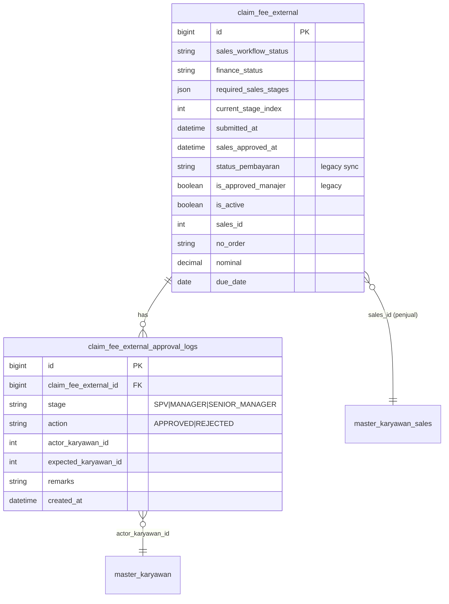

# ERD, Migrasi & Kontrak API — Claim Fee External

> **Fase 0** — belum dieksekusi di DB production  
> Roadmap ref: v1.2  
> Controller: `ClaimFeeExternalController` (perlu refactor Fase 1)

---

## 1. Diagram ERD (logis)



---

## 2. Tabel `claim_fee_external` — kolom

### 2.1 Legacy (sudah dipakai kode — jangan dihapus Fase 1)

| Kolom | Catatan |
|-------|---------|
| `id` | PK |
| `no_order`, `nama_perusahaan`, `no_quotation`, `no_invoice`, `periode` | Order |
| `nama_penerima`, `nama_bank`, `no_rekening`, `metode_pembayaran` | Pembayaran |
| `nominal`, `biaya_akhir`, `potongan`, `nominal_bayar` | Angka |
| `due_date`, `tanggal_pembayaran` | Tanggal |
| `status_pembayaran` | Legacy — di-sync dari `finance_status` + workflow |
| `sales_id` | Penjual (submitter bisnis) |
| `is_approved_manajer`, `approved_manajer_by`, `approved_manajer_at` | Legacy manajer tunggal |
| `processed_by`, `processed_at`, `transferred_by` | Finance |
| `rejected_by`, `rejected_at` | Bisa sales atau finance |
| `filename` | PDF tax |
| `is_active` | Soft delete |
| `created_by`, `created_at`, `updated_by`, `updated_at`, `deleted_by`, `deleted_at` | Audit |

> **Fase 1:** jalankan `DESCRIBE claim_fee_external` di staging; sesuaikan migration jika ada kolom tambahan di DB.

### 2.2 Baru (Fase 1 migration)

| Kolom | Tipe | Default | Index |
|-------|------|---------|-------|
| `sales_workflow_status` | `VARCHAR(32)` | `SUBMITTED` | IDX |
| `finance_status` | `VARCHAR(32)` | `NULL` | IDX |
| `required_sales_stages` | `JSON` | `NULL` | — |
| `current_stage_index` | `INT UNSIGNED` | `0` | — |
| `submitted_at` | `DATETIME` | `NULL` | IDX |
| `sales_approved_at` | `DATETIME` | `NULL` | — |
| `finance_locked_at` | `DATETIME` | `NULL` | Opsional Q4: set saat masuk `WAITING_TAX` |

### 2.3 Enum kode (aplikasi — bukan MySQL ENUM)

**`sales_workflow_status`:**  
`SUBMITTED`, `PENDING_SPV`, `PENDING_MANAGER`, `PENDING_SENIOR_MANAGER`, `APPROVED_SALES`, `REJECTED_SALES`, `CANCELLED`

**`finance_status`:**  
`NULL` (belum masuk finance), `WAITING_TAX`, `TAX_IN_PROGRESS`, `READY_TO_PAY`, `PAID`, `REJECTED_FINANCE`

### 2.4 `required_sales_stages` JSON

Contoh: `["SPV","MANAGER","SENIOR_MANAGER"]` atau `["SPV","MANAGER"]` (Q6 tanpa SM).

**Atasan tingkat 1 (Q5):** `required_sales_stages[0]`.

---

## 3. Tabel baru `claim_fee_external_approval_logs`

| Kolom | Tipe | Keterangan |
|-------|------|------------|
| `id` | BIGINT PK AI | |
| `claim_fee_external_id` | BIGINT FK | → `claim_fee_external.id` |
| `stage` | VARCHAR(24) | SPV, MANAGER, SENIOR_MANAGER |
| `action` | VARCHAR(16) | APPROVED, REJECTED |
| `actor_karyawan_id` | INT | User login |
| `expected_karyawan_id` | INT NULL | Hasil resolver |
| `remarks` | VARCHAR(500) NULL | Wajib jika REJECTED |
| `created_at` | DATETIME | |

Index: `(claim_fee_external_id)`, `(stage, action)`.

---

## 4. Draft migration (Laravel)

File: `database/migrations/2026_11_19_100000_claim_fee_external_workflow_draft.php`  
Status: **DRAFT Fase 0** — rename/hapus suffix `_draft` saat Fase 1 deploy.

Prinsip:

- `Schema::hasColumn` guard untuk idempotensi.  
- Backfill script di `up()` setelah alter (atau command terpisah `MigrateClaimFeeExternalWorkflow`).

### Mapping backfill (data lama)

| Kondisi | `sales_workflow_status` | `finance_status` |
|---------|-------------------------|------------------|
| `REJECTED` + belum pernah transfer | `REJECTED_SALES` atau `REJECTED_FINANCE` (heuristik `transferred_by`) | sesuai |
| `WAITING` + `!is_approved_manajer` | `PENDING_MANAGER` atau `SUBMITTED` | NULL |
| `WAITING` + `is_approved_manajer` | `APPROVED_SALES` | `WAITING_TAX` |
| `PROCESSED` | `APPROVED_SALES` | `TAX_IN_PROGRESS` |
| `READY TO TRANSFER` | `APPROVED_SALES` | `READY_TO_PAY` |
| `TRANSFER` | `APPROVED_SALES` | `PAID` |

Log sintetis: 1× APPROVED MANAGER jika `is_approved_manajer = 1`.

---

## 5. Service domain (Fase 1)

### `ClaimFeeExternalSalesWorkflowService`

| Method | Fungsi |
|--------|--------|
| `buildRequiredStages(MasterKaryawan $seller)` | Q6: max SM, else stop MGR |
| `resolveApproverForStage(ClaimFeeExternal $claim, string $stage)` | DynamicApprovalChainService |
| `submitOrUpdate(ClaimFeeExternal $claim, array $payload)` | store; set stages + PENDING_* |
| `approveSales(int $claimId, MasterKaryawan $actor)` | log + advance index / APPROVED_SALES |
| `rejectSales(int $claimId, MasterKaryawan $actor, string $remarks)` | REJECTED_SALES |
| `buildPipeline(ClaimFeeExternal $claim)` | untuk drawer |
| `canEdit(ClaimFeeExternal $claim)` | Q5: no APPROVED log stage index 0 |
| `canApprove(ClaimFeeExternal $claim, MasterKaryawan $viewer)` | |
| `syncLegacyStatus(ClaimFeeExternal $claim)` | status_pembayaran |

### `ClaimFeeExternalNotificationService` (Fase 1–3)

Dipanggil **setelah commit** dari workflow/finance. Event codes & copy: `CLAIM_FEE_EXTERNAL_NOTIFIKASI.md`.

| Method | Fungsi |
|--------|--------|
| `notifyApprovalPending(ClaimFeeExternal $claim)` | Ke resolver approver tahap aktif |
| `notifySubmitter(string $eventCode, ClaimFeeExternal $claim, array $ctx)` | Ke `sales_id` — **wajib** tiap lompatan status |

### `ClaimFeeExternalStatusSyncService`

Memetakan `finance_status` ↔ `status_pembayaran` untuk Tax/Expense tanpa refactor besar Fase 1.

---

## 6. Kontrak API (X-Slice)

Base: `POST REACT_APP_ROUTE`, header `X-Slice`, `token`.

### 6.1 Metadata menu (opsional Fase 2)

| Slice | Method | Deskripsi |
|-------|--------|-----------|
| `getTabAccess` | GET/POST | `{ tabs: [], grade, defaultTab }` |

### 6.2 Tab Pengajuan

| Slice | Auth | Filter scope |
|-------|------|--------------|
| `pengajuanIndex` | view | `sales_id = user` (staff); MGR/SM own claims only di tab ini |
| `store` | create/update | Guard SPV 403; guard Q5 `canEdit`; guard Q4 no edit finance |
| `delete` | delete | Same as canEdit + not finance |
| `getOrders` | — | existing |
| `getOrderDetail` | — | existing |
| `getOrderByKontrak` | — | existing |

**`store` body (existing + opsional):**

```json
{
  "id": null,
  "no_order": "...",
  "nominal": 1000000,
  "tanggal_claim": "2026-11-30",
  "metode_bayar": "TRANSFER",
  "bank": "BCA",
  "no_rekening": "...",
  "nama_penerima": "...",
  "nama_perusahaan": "...",
  "no_quotation": "...",
  "no_invoice": "...",
  "biaya_akhir": 5000000,
  "periode": null
}
```

**Response 201:** `{ "message", "data": { "id", "sales_workflow_status", "can_edit" } }`

**Errors:** 403 SPV; 422 nominal; 403 edit setelah tingkat 1; 409 finance locked.

### 6.3 Tab Persetujuan

| Slice | Auth | Query logic |
|-------|------|-------------|
| `persetujuanIndex` | approve | Claims where `current stage` + resolver = viewer karyawan_id |
| `approveSales` | approve | `{ "id" }` |
| `rejectSales` | reject | `{ "id", "remarks" }` |

**Filter SPV Q7:** exclude claim where log exists `SPV APPROVED` by viewer (hilang dari antrian).

**`approveSales` response:** `{ "message", "data": { "sales_workflow_status", "next_stage_label" } }`

### 6.4 Tab Menunggu Finance

| Slice | Scope |
|-------|-------|
| `menungguFinanceIndex` | `sales_workflow_status = APPROVED_SALES` AND `finance_status` NOT NULL AND not PAID/REJECTED_FINANCE optional |
| Staff: `sales_id = self` | |
| MGR: bawahan | |
| SM: no filter | |
| SPV: **403** | |

### 6.5 Tab Rekap

| Slice | Scope |
|-------|-------|
| `rekapIndex` | DataTables agregat |
| `rekapSummary` | KPI cards |
| `rekapExport` | export permission |

| Grade | Scope |
|-------|-------|
| Staff / SPV | **403** |
| Manager | `sales_id IN bawahan` |
| SM | **all data** |

Query params: `year`, `month`, `sales_workflow_status`, `finance_status`, `sales_id` (MGR filter opsional).

### 6.6 Detail

| Slice | Response |
|-------|----------|
| `show` | `{ claim, pipeline[], permissions: { can_edit, can_delete, can_approve, can_reject } }` |

**`pipeline[]` item:**

```json
{
  "key": "PENDING_SPV",
  "label": "Menunggu SPV",
  "state": "pending|done|rejected|skipped",
  "actor_name": null,
  "acted_at": null,
  "expected_approver_name": "Nama dari resolver"
}
```

### 6.7 Finance (perubahan minimal — Fase 3)

Tetap `ClaimFeeExternalTaxController` / `ExpenseController`; ganti WHERE:

- Dari `is_approved_manajer = true`  
- Ke `sales_workflow_status = 'APPROVED_SALES'` AND `is_active = 1`

Setelah aksi finance → panggil `syncLegacyStatus` + set `finance_status`.

**Reject finance (Q4):** set `REJECTED_FINANCE`; `store` dengan `id` tersebut → 409.

### 6.8 Deprecated slices

| Lama | Pengganti |
|------|-----------|
| `outstandingIndex` / `settlementIndex` | `pengajuanIndex` + `menungguFinanceIndex` |
| `ApprovalFeeExternalController@index` | `persetujuanIndex` |
| `approve` / `reject` approval lama | `approveSales` / `rejectSales` |

---

## 7. Aturan `permissions` (server)

```text
can_edit     = owner sales_id AND canEdit() AND create/update menu
can_delete   = can_edit AND delete menu
can_approve  = persetujuanIndex logic AND approve menu
can_reject   = can_approve AND reject menu
```

---

## 8. Frontend tab routing

Query: `/sales/claim-fee-external?tab=pengajuan|persetujuan|menunggu-finance|rekap`

`getVisibleTabs()` dari `getTabAccess` atau derive grade dari profile API existing.

---

## 9. Kriteria selesai Fase 1 (pratinjau)

- Migration staging sukses + backfill  
- Unit test: stages tanpa SM, canEdit Q5, SPV store 403  
- `show` pipeline 3 tahap  
- Finance gate `APPROVED_SALES` di Tax index (minimal)

---

**Versi dokumen:** 1.0 (Fase 0)